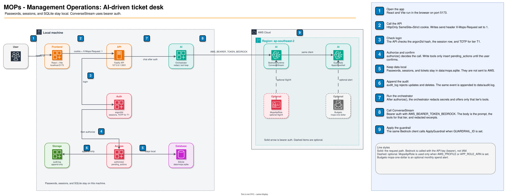
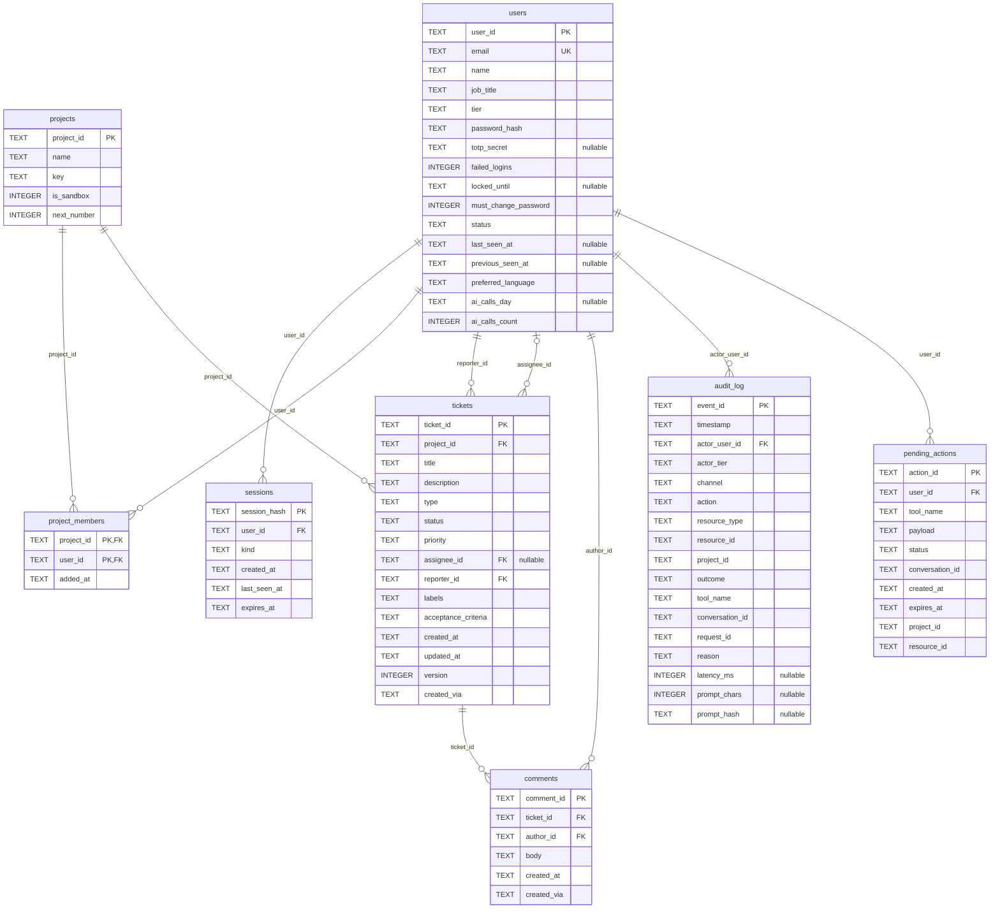

English | [繁體中文](README.zh-TW.md)

# 🧹🪣 MOPs - Management Operations: AI-driven ticket desk

An AI-assisted ticket desk. The React app, the API, SQLite, and login run on your machine. Amazon Bedrock and Guardrails stay in AWS.

Authorization is enforced in the API. The model never decides what a user may do, write tools only create a pending action, and ticket text is treated as untrusted data. Admin users do not receive ticket content, including in the audit log.


## Trust ladder

- Level 1, this build: the assistant can read and propose. Every write waits for confirmation.
- Level 2, later: low-risk comments and status changes could run with undo.
- Level 3, later: proactive suggestions and scheduled digests.
- Deletes and bulk creates always wait for confirmation.

## Prerequisites

- Node.js 22 or newer
- An AWS account that can call Bedrock in your `AWS_REGION` (the example uses `ap-southeast-2`)
- A 30-day long-term Bedrock API key for local and demo use

## Setup

```bash
npm install
cp .env.example .env
```

Fill `SESSION_SECRET`, `TOTP_KEY`, `AWS_BEARER_TOKEN_BEDROCK`, and `BEDROCK_MODEL_ID`. Optional guardrail steps and the IAM controls for the key are in [infra/README.md](infra/README.md).

### Bedrock API key

Create a **long-term** key in the Amazon Bedrock console: API keys, Long-term API keys, expiration **30 days**. Put the value only in `AWS_BEARER_TOKEN_BEDROCK` in `.env`. The API also needs `AWS_REGION` and `BEDROCK_MODEL_ID`. Leave `AWS_PROFILE` and `APP_ROLE_ARN` empty unless you intentionally want SigV4 instead of the key.

This is a temporary local/demo exception to **SEC-4** in [artifacts/PRD-v1-1.md](artifacts/PRD-v1-1.md). SEC-4 says local access uses IAM Identity Center or a short-lived role, never a long-lived key. A 30-day Bedrock API key is allowed here so the demo can run without SSO. It is not the production pattern.

The key is read only by `apps/api`. It is not sent to `apps/web`, and the server does not log it. `.env` is gitignored. Do not commit the key.

To rotate or revoke it: in the Bedrock console open API keys, select the key, then Deactivate, Reset, or Delete. You can also call `aws iam update-service-specific-credential` or `aws iam delete-service-specific-credential` with the key's `ServiceSpecificCredentialId`. Put the new value in `.env` and restart the API. A deactivated or deleted key stops working immediately.

Before you commit, run [gitleaks](https://github.com/gitleaks/gitleaks) so a pasted key does not land in git:

```bash
gitleaks detect --source . --redact
```

```bash
npm run seed
npm run dev
```

The UI is http://localhost:5173 and the API is http://127.0.0.1:3001.

The session cookie is HttpOnly and SameSite=Strict. The browser sends `X-Mops-Request: 1` on writes. The language choice before login may stay in localStorage. Passwords and the session id do not.

`data/mops.sqlite` is gitignored. On Windows, keep that disk encrypted with BitLocker. The audit table rejects updates and deletes, and the same events are appended to `data/audit.log` without ticket text.

## Demo users

`npm run seed` gives every demo user a password. Set `DEMO_PASSWORD` in `.env` (12 to 200 characters; see `.env.example`) to share one password. Seed then prints a warning that the shared password is for the local demo only. Leave `DEMO_PASSWORD` unset and seed prints a random password for each person once. Ada (T1) gets an authenticator secret. Seed prints the base32 secret and an `otpauth://` URL once. Add that secret to an authenticator app and use its current code. The secret is not written to the audit log, and it is not printed again. If you lose it, delete the database and seed again. The demo code `000000` works only when `DEMO_TOTP_BYPASS=true`. That flag is off by default, including in Docker. When it is on, the API prints a warning at startup. Leave it unset for any real deployment.

- ada.admin@mops.example, Admin/IT, T1, English, Sandbox. Second step is the code from the authenticator secret printed by seed. With `DEMO_TOTP_BYPASS=true`, the second step is `000000`.
- chris.chen@mops.example, CTO, T2, English, Apollo, Helios, and Nexus
- maya.chen@mops.example, Product Manager, T2, English, Apollo and Helios
- sam.lee@mops.example, Developer, T3, Traditional Chinese, Apollo
- jordan.wu@mops.example, Developer, T3, English, Apollo and Nexus
- riley.park@mops.example, Developer, T3, English, Helios

APOLLO-5 has an English comment that tries to instruct the assistant. APOLLO-8 has the same kind of comment in Chinese.

## Run with Docker

Docker Compose starts the UI and the API together. You still fill in `.env`. That file is not copied into either image.

```bash
cp .env.example .env
```

Fill `SESSION_SECRET`, `TOTP_KEY`, `AWS_BEARER_TOKEN_BEDROCK`, and `BEDROCK_MODEL_ID`. `DEMO_PASSWORD` is optional (12 to 200 characters).

```bash
docker compose up --build
```

Later starts can use `docker compose up`. The UI is http://localhost:5173 and the API is http://localhost:3001. Compose publishes both ports on `127.0.0.1` only.

The page calls `/api` on the same origin. The web container proxies that path to the API on the Compose network. The browser stays on http://localhost:5173, so the HttpOnly SameSite=Strict session cookie and the `X-Mops-Request: 1` header still apply. `npm run dev` is unchanged: the dev server still uses `VITE_API_URL` from `.env` (http://localhost:3001) and the API still binds `127.0.0.1`. Inside Compose the API listens on `0.0.0.0` so the web container and the published port can reach it.

The API reads `.env` through Compose `env_file` when the container starts. Containers run as a non-root user.

The first start seeds demo data when the database file is missing. Passwords and Ada's authenticator secret are printed once in the API logs:

```bash
docker compose logs api
```

With `DEMO_PASSWORD` set, every demo user shares that password and the log includes the local-demo warning. Without it, each person gets a random password in that log. T2 and T3 users sign in with the password only. Ada (T1): copy the base32 secret from that first log (the line under `Ada authenticator secret`) into an authenticator app, or open the `otpauth://` URL. `DEMO_TOTP_BYPASS=true` in `.env` is a demo-only shortcut that accepts `000000` and logs a startup warning. Compose does not set that flag. The accounts are listed under Demo users above.

SQLite and the audit log are stored on the named volume `mops-data` (`/data/mops.sqlite` and `/data/audit.log` in the API container). The authenticator secret is not in the audit log. `docker compose down` keeps the volume. The next `docker compose up` sees the database and skips seeding, so the secret is not printed again. `docker compose down -v` deletes the volume. The next start seeds again and prints a new secret.

## Scripts

- `npm test` checks permissions, redaction, lockout, session expiry, T1 one-time codes, and the audit triggers.
- `npm run check:i18n` fails when the English and Traditional Chinese files diverge.
- `python3 scripts/render-db-schema.py` redraws `docs/db-schema.png` and `docs/db-schema.zh-TW.png` from these Mermaid blocks via `npx -y @mermaid-js/mermaid-cli@11.12.0` (`-t dark -s 2`). It needs Chrome and Noto Sans CJK TC. `mmdc` is not an npm dependency.
- `npm run eval` sends the bilingual prompt set through the real orchestrator and spends Bedrock credits.
- `npm run check:aws` checks `AWS_BEARER_TOKEN_BEDROCK`, `AWS_REGION`, and `BEDROCK_MODEL_ID` with one short Converse call. It does not call STS. Bedrock API keys cannot call `GetCallerIdentity`.
- `npm audit` before you present the project.

## Architecture

The browser, the API, passwords, sessions, and SQLite stay on the machine. Amazon Bedrock in `ap-southeast-2` receives the prompt, the tool definitions for that tier, redacted ticket excerpts, and the language preference. The API calls Bedrock Runtime `ConverseStream` with the Bedrock API key in `AWS_BEARER_TOKEN_BEDROCK` (bearer auth). `AWS_PROFILE` and `APP_ROLE_ARN` (`MopsApiRole`) are an optional SigV4 override, drawn with a dashed line. AWS Budgets `mops-one-dollar` is an optional spend alert, also dashed. `ApplyGuardrail` runs on the same client when `GUARDRAIL_ID` is set.



Editable source: [docs/architecture.drawio](docs/architecture.drawio).

## Database Schema

SQLite file `data/mops.sqlite`, created from [apps/api/src/db/schema.sql](apps/api/src/db/schema.sql). `schema.sql` has no `FOREIGN KEY` or `REFERENCES` clauses. `apps/api/src/db/sqlite.ts` turns `foreign_keys` on, and with nothing declared SQLite does not enforce the links below. The API checks them in code. `tickets.assignee_id` may be null. `tickets.reporter_id` is required. `audit_log.project_id` and `pending_actions.project_id` are plain text and may be an empty string, so they are not drawn as foreign keys. `pending_actions.resource_id` is a ticket id or an empty string.



Diagram not rendering (e.g. on the GitHub mobile app)? [View the database schema as an image](docs/db-schema.png)

`project_members.project_id` and `project_members.user_id` are a composite primary key. Both are logical foreign keys, to `projects` and `users`.

`audit_log` is append-only. Triggers `audit_no_update` and `audit_no_delete` run `BEFORE UPDATE` and `BEFORE DELETE` and abort with `audit_append_only`. The same events are also appended to `data/audit.log` without ticket text.

Secondary indexes:

- `members_by_user` on `project_members (user_id)`
- `tickets_by_project` on `tickets (project_id)`
- `tickets_by_assignee` on `tickets (assignee_id)`
- `tickets_by_status` on `tickets (status)`
- `comments_by_ticket` on `comments (ticket_id, created_at)`
- `audit_by_time` on `audit_log (timestamp)`

## Assumptions

- A developer may comment on and change the status of any ticket in a member project.
- A product manager or CTO may edit and delete tickets only in member projects.
- Comments cannot be edited or deleted.
- A job title containing "CTO" selects the short cross-project briefing.
- Chinese means Traditional Chinese.
- The visual layout follows the design guidelines: a top header, not a left rail.
- Authentication, data access, and secrets sit behind local implementations so they can later move to Cognito, DynamoDB, and Secrets Manager without rewriting ticket rules.
