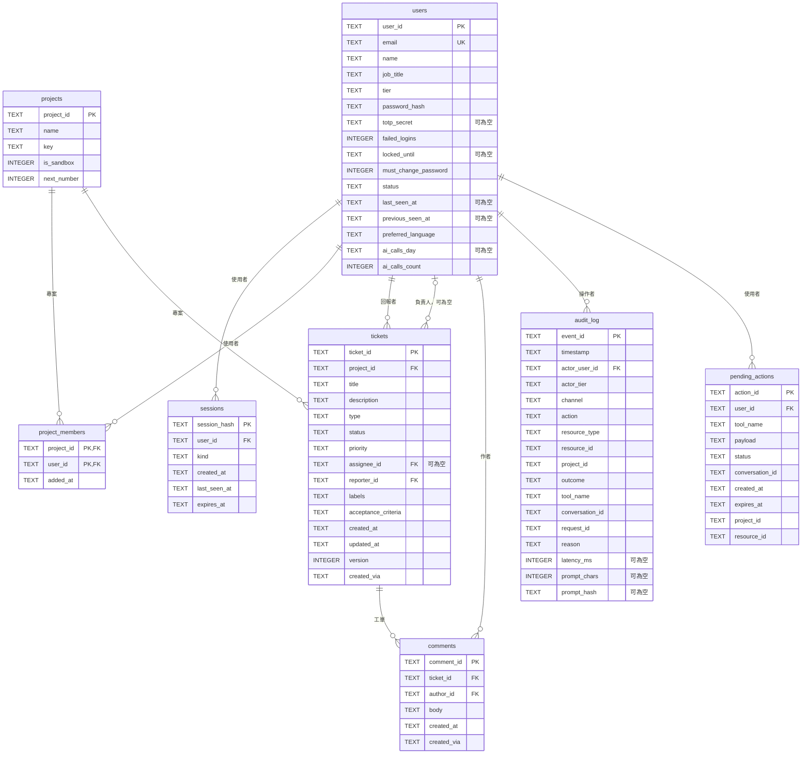

[English](README.md) | 繁體中文

# 🧹🪣 MOPs - Management Operations：AI 驅動的工單台

人工智慧輔助的工單台。React 應用程式、API、SQLite 與登入都在你的電腦上執行。Amazon Bedrock 與 Guardrails 留在 AWS。

授權在 API 裡執行。模型不能決定使用者可以做什麼，寫入工具只會建立待確認的動作，工單文字一律當成不可信的資料。管理使用者不會收到工單內容，稽核紀錄裡也沒有。

## 信任階梯

- 第 1 級，這個版本：助理可以讀取與提案。每次寫入都要等確認。
- 第 2 級，之後：低風險的留言與狀態變更可以先執行，再提供復原。
- 第 3 級，之後：主動建議與排程摘要。
- 刪除與大量建立一律等待確認。

## 事前準備

- Node.js 22 或更新版本
- 能在 `AWS_REGION` 呼叫 Bedrock 的 AWS 帳戶（範例使用 `ap-southeast-2`）
- 供本機與展示使用的 30 天長期 Bedrock API 金鑰

## 設定

```bash
npm install
cp .env.example .env
```

填入 `SESSION_SECRET`、`TOTP_KEY`、`AWS_BEARER_TOKEN_BEDROCK` 與 `BEDROCK_MODEL_ID`。選用的防護欄步驟，以及這把金鑰的 IAM 控制，寫在 [infra/README.md](infra/README.md)。

### Bedrock API 金鑰

在 Amazon Bedrock 主控台建立**長期**金鑰：API keys、Long-term API keys，到期日 **30 天**。只把值放在 `.env` 的 `AWS_BEARER_TOKEN_BEDROCK`。API 還需要 `AWS_REGION` 與 `BEDROCK_MODEL_ID`。除非你故意要改用 SigV4，否則把 `AWS_PROFILE` 與 `APP_ROLE_ARN` 留空。

這是 [artifacts/PRD-v1-1.md](artifacts/PRD-v1-1.md) 裡 **SEC-4** 的暫時本機／展示例外。SEC-4 規定本機存取使用 IAM Identity Center 或短期角色，不用長期金鑰。這裡允許 30 天的 Bedrock API 金鑰，是為了不必走 SSO 就能跑展示。這不是正式環境的做法。

金鑰只由 `apps/api` 讀取。它不會送到 `apps/web`，伺服器也不會把它寫進紀錄。`.env` 已被 git 忽略。不要提交這把金鑰。

輪替或撤銷：在 Bedrock 主控台開啟 API keys，選取金鑰，再按 Deactivate、Reset 或 Delete。也可以用金鑰的 `ServiceSpecificCredentialId` 呼叫 `aws iam update-service-specific-credential` 或 `aws iam delete-service-specific-credential`。把新值放進 `.env` 並重新啟動 API。停用或刪除會立刻生效。

提交前先跑 [gitleaks](https://github.com/gitleaks/gitleaks)，避免貼上的金鑰進入 git：

```bash
gitleaks detect --source . --redact
```

```bash
npm run seed
npm run dev
```

介面是 http://localhost:5173，API 是 http://127.0.0.1:3001。

工作階段 Cookie 是 HttpOnly 且 SameSite=Strict。瀏覽器在寫入時送出 `X-Mops-Request: 1`。登入前選擇的語言可以留在 localStorage。密碼與工作階段識別碼不會。

`data/mops.sqlite` 已被 git 忽略。在 Windows 上，請用 BitLocker 加密那顆磁碟。稽核資料表拒絕更新與刪除，同一批事件會追加到 `data/audit.log`，而且不含工單文字。

## 展示用使用者

`npm run seed` 會給每位展示用使用者一組密碼。在 `.env` 設定 `DEMO_PASSWORD`（12 到 200 個字元，見 `.env.example`）可共用同一組密碼。種子程式接著會印出警告，說明共用密碼只供本機展示。不設定 `DEMO_PASSWORD` 時，種子程式會為每個人印出一次隨機密碼。Ada（T1）需要驗證器產生的真正一次性驗證碼。展示用驗證碼 `000000` 只在 `DEMO_TOTP_BYPASS=true` 時有效。這個旗標預設關閉，Docker 裡也一樣。開啟時，API 會在啟動時印出警告。正式環境請不要設定。

- ada.admin@mops.example，管理／資訊，T1，英文，Sandbox。`DEMO_TOTP_BYPASS=true` 時，第二步驟是 `000000`。否則請用她的真正 TOTP 驗證碼。
- chris.chen@mops.example，CTO，T2，英文，Apollo、Helios 與 Nexus
- maya.chen@mops.example，產品經理，T2，英文，Apollo 與 Helios
- sam.lee@mops.example，開發人員，T3，繁體中文，Apollo
- jordan.wu@mops.example，開發人員，T3，英文，Apollo 與 Nexus
- riley.park@mops.example，開發人員，T3，英文，Helios

APOLLO-5 有一則英文留言，試圖指示助理。APOLLO-8 有同樣性質的中文留言。

## 用 Docker 執行

Docker Compose 會一起啟動介面與 API。你仍然要填 `.env`。那個檔案不會被複製進任何一個映像。

```bash
cp .env.example .env
```

填入 `SESSION_SECRET`、`TOTP_KEY`、`AWS_BEARER_TOKEN_BEDROCK` 與 `BEDROCK_MODEL_ID`。`DEMO_PASSWORD` 可選（12 到 200 個字元）。

```bash
docker compose up --build
```

之後可以只用 `docker compose up`。介面是 http://localhost:5173，API 是 http://localhost:3001。Compose 只把這兩個連接埠發佈在 `127.0.0.1`。

頁面呼叫同一個來源的 `/api`。web 容器把這個路徑代理到 Compose 網路上的 API。瀏覽器留在 http://localhost:5173，所以 HttpOnly、SameSite=Strict 的工作階段 Cookie，以及 `X-Mops-Request: 1` 標頭仍然有效。`npm run dev` 不變：開發伺服器仍使用 `.env` 的 `VITE_API_URL`（http://localhost:3001），API 仍綁定 `127.0.0.1`。在 Compose 裡，API 監聽 `0.0.0.0`，web 容器與對外的連接埠才連得上。

API 在容器啟動時透過 Compose 的 `env_file` 讀取 `.env`。容器以非 root 使用者執行。

第一次啟動時，若資料庫檔案不存在，會寫入展示資料。密碼只在 API 紀錄裡印出一次：

```bash
docker compose logs api
```

有設定 `DEMO_PASSWORD` 時，每位展示用使用者共用該密碼，紀錄裡也會有只供本機展示的警告。沒有設定時，每個人的隨機密碼都在那份紀錄裡。T2 與 T3 只需要密碼。Ada（T1）需要真正的 TOTP 驗證碼，除非在啟動 API 前於 `.env` 設定 `DEMO_TOTP_BYPASS=true`。Compose 不會開啟這個旗標。設為 true 時，啟動紀錄會有警告，並接受 `000000`。帳號列在上方的「展示用使用者」。

SQLite 與稽核紀錄放在具名磁碟區 `mops-data`（API 容器裡的 `/data/mops.sqlite` 與 `/data/audit.log`）。`docker compose down` 會保留磁碟區。下一次 `docker compose up` 看到資料庫就略過種子資料。`docker compose down -v` 會刪除磁碟區。下一次啟動會再寫入種子資料。

## 指令

- `npm test` 檢查權限、遮罩、鎖定、工作階段到期、T1 一次性驗證碼，以及稽核觸發器。
- `npm run check:i18n` 會在英文與繁體中文檔案不一致時失敗。
- `python3 scripts/render-db-schema.py` 用 `npx -y @mermaid-js/mermaid-cli@11.12.0`（`-t dark -s 2`）依這些 Mermaid 區塊重畫 `docs/db-schema.png` 與 `docs/db-schema.zh-TW.png`。需要 Chrome 與 Noto Sans CJK TC。`mmdc` 不是 npm 依賴。
- `npm run eval` 把雙語提示集送進真正的協調器，並消耗 Bedrock 額度。
- `npm run check:aws` 用一次短暫的 Converse 呼叫檢查 `AWS_BEARER_TOKEN_BEDROCK`、`AWS_REGION` 與 `BEDROCK_MODEL_ID`。它不呼叫 STS。Bedrock API 金鑰不能呼叫 `GetCallerIdentity`。
- 展示專案前先跑 `npm audit`。

## 架構

瀏覽器、API、密碼、工作階段與 SQLite 都留在這台機器上。`ap-southeast-2` 的 Amazon Bedrock 收到的是提示、該層級的工具定義、遮罩後的工單摘錄，以及語言偏好。API 用 `AWS_BEARER_TOKEN_BEDROCK` 裡的 Bedrock API 金鑰（Bearer 驗證）呼叫 Bedrock Runtime `ConverseStream`。`AWS_PROFILE` 與 `APP_ROLE_ARN`（`MopsApiRole`）是選用的 SigV4 覆寫，以虛線畫出。AWS Budgets 的 `mops-one-dollar` 是選用的花費警示，同樣以虛線表示。設定了 `GUARDRAIL_ID` 時，同一個用戶端會呼叫 `ApplyGuardrail`。


可編輯的來源：[docs/architecture.zh-TW.drawio](docs/architecture.zh-TW.drawio)。

## 資料庫結構

SQLite 檔案 `data/mops.sqlite` 由 [apps/api/src/db/schema.sql](apps/api/src/db/schema.sql) 建立。`schema.sql` 沒有 `FOREIGN KEY` 或 `REFERENCES` 子句。`apps/api/src/db/sqlite.ts` 會開啟 `foreign_keys`，但因為沒有宣告任何條件，SQLite 不會強制下面這些關聯。API 在程式裡檢查它們。`tickets.assignee_id` 可以是 null。`tickets.reporter_id` 必填。`audit_log.project_id` 與 `pending_actions.project_id` 是純文字，可以是空字串，所以沒有畫成外鍵。`pending_actions.resource_id` 是工單識別碼或空字串。



圖表無法顯示（例如在 GitHub 手機 App）？[點此查看資料庫結構圖片](docs/db-schema.zh-TW.png)

`project_members.project_id` 與 `project_members.user_id` 是複合主鍵。兩者都是邏輯外鍵，分別指向 `projects` 與 `users`。

`audit_log` 只追加。觸發器 `audit_no_update` 與 `audit_no_delete` 在 `BEFORE UPDATE` 與 `BEFORE DELETE` 執行，並以 `audit_append_only` 中止。同一批事件也會追加到 `data/audit.log`，而且不含工單文字。

次要索引：

- `members_by_user`，欄位 `project_members (user_id)`
- `tickets_by_project`，欄位 `tickets (project_id)`
- `tickets_by_assignee`，欄位 `tickets (assignee_id)`
- `tickets_by_status`，欄位 `tickets (status)`
- `comments_by_ticket`，欄位 `comments (ticket_id, created_at)`
- `audit_by_time`，欄位 `audit_log (timestamp)`

## 假設

- 開發人員可以在所屬專案的任何工單留言，並變更狀態。
- 產品經理或 CTO 只能在所屬專案編輯與刪除工單。
- 留言不能編輯或刪除。
- 職稱包含「CTO」時，使用簡短的跨專案簡報。
- 中文是指繁體中文。
- 版面依設計指南：上方標題列，不是左側導覽。
- 驗證、資料存取與機密都放在本機實作後面，之後可以改接 Cognito、DynamoDB 與 Secrets Manager，不必重寫工單規則。
